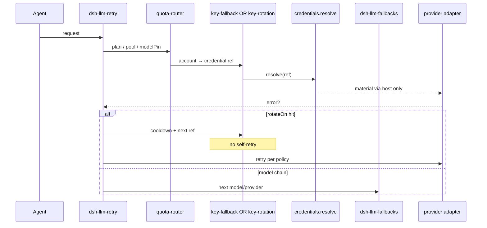
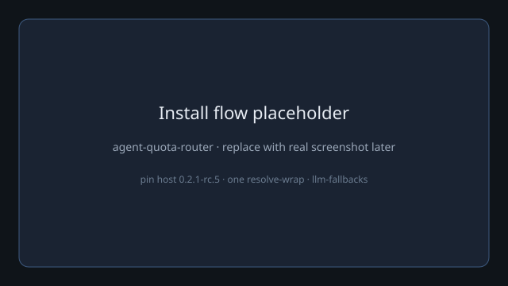
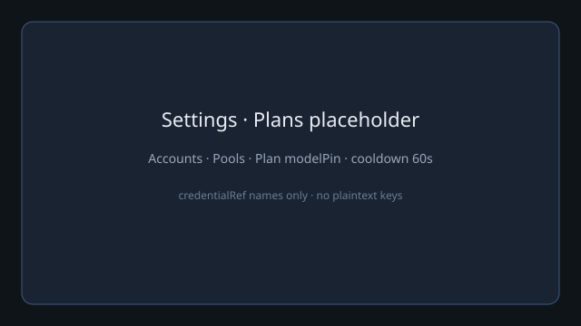

# agent-quota-router

**狀態：M0 scaffold（組裝指南＋設定契約＋純 TypeScript 選帳 helpers）——唔係生產完整路由器產品。**

KINFX 嘅 **L2 額度／帳號池組裝層**：用 **credential ref**（唔係明文 key）組成 AccountPool，按 **Plan** 套用 modelPin，並喺 cooldown 下揀下一個帳。  
公開名：`agent-quota-router`。  
**同 DeepSeek、xAI 或其他 LLM 廠商無隸屬關係（not affiliated）。** 技術段可寫「相容 DSH（DeepSeek Harness）」；**唔**以 Grok／DeepSeek 做產品名。

架構與責任邊界見 [`docs/assembly.md`](docs/assembly.md) · [`docs/boundaries.md`](docs/boundaries.md) · 規格筆記 `kinfx-dsh-quota-router-spec-v0`。

## English (short)

M0 **assembly guide + QuotaRouterConfig v0 contract + pure helpers** (`selectAccountForPlan` / `applyCooldown` / `isInCooldown`). **No HTTP to LLMs. No plaintext keys.** Pin host `@deepseek-ai/dsh@0.2.1-rc.5`. Install **exactly one** resolve-wrap (`@omdp/dsh-key-fallback` **or** `@goodandready/dsh-key-rotation` — never both). Model chain = `dsh-llm-fallbacks`. Retry = host `dsh-llm-retry`. MIT.

## 架構（spec §3）







## 設定契約

- Schema：[`config/quota-router.schema.json`](config/quota-router.schema.json)
- 例子：[`config/quota-router.example.yaml`](config/quota-router.example.yaml)（假 ref：`cred_ref_demo_a`）
- 預設：`defaultCooldownMs: 60000` · `stayInPoolUnlessFallbackEnabled: true`

## 開發

```bash
npm ci
npm run check   # build + vitest + hygiene
npm run health  # --dry config load
```

## 免責（多帳／ToS — 用戶自責）

多帳號／多 credential 自動輪換可能受各供應商服務條款與使用政策限制（包括多帳、帳號共享、限流與計費）。**用戶須自行確保**每一項憑證均為合法授權用途；本軟體**唔**鼓勵亦**唔**協助以多帳規避使用限制或計費義務。正式長期使用前應對官方 ToS **開頁**核實（未開頁＝未能核實）。*Not legal advice.*

## 授權

MIT · Copyright (c) 2026 KINFX · 見 [LICENSE](LICENSE) / [NOTICE](NOTICE)
