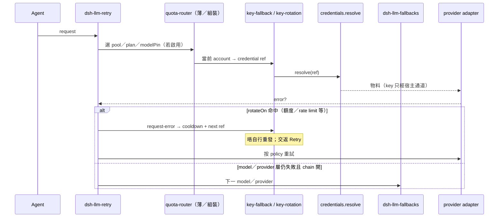

# 組裝指南 · agent-quota-router

狀態：M0 · 組裝優先 · 對齊 `kinfx-dsh-quota-router-spec-v0` §3–§6  
宿主釘版：**`@deepseek-ai/dsh@0.2.1-rc.5`**

## 責任邊界（唔重複做）

| 元件 | 負責 | **唔**負責 |
|------|------|------------|
| `credentials.resolve`（宿主） | 按 ref 取密物料 | 池策略 |
| `dsh-llm-retry` | 是否重發、次數、backoff | 選邊把 key |
| `@omdp/dsh-key-fallback` **或** `@goodandready/dsh-key-rotation` | 包裝 resolve；池內換 ref；cooldown | 重發；同時間雙掛 |
| `dsh-llm-fallbacks` | 換 model／provider chain | 帳號 cooldown 帳本 |
| **agent-quota-router** | Plan 表、池編排、modelPin、純函式選帳 | 自己 HTTP 打 LLM；自己存明文 key；重造 retry |

## 硬規則：resolve-wrap 只裝一個

同一時間只允許 **exactly ONE** 寫入／包裝 `credentials.resolve` 嘅主插件：

- 推薦預設：`@omdp/dsh-key-fallback`
- 可選替代：`@goodandready/dsh-key-rotation`（**代替**，唔並裝）

**Never both.** 雙包裝會令次序同 cooldown 語意失控。

## 建議安裝順序（文件組裝）

1. 安裝並釘宿主：`npm i -g @deepseek-ai/dsh@0.2.1-rc.5`（或專案 peer）。
2. 裝 **一個** resolve-wrap（上表二選一）。
3. 裝 `dsh-llm-fallbacks`（model／provider chain）。
4. 重試留給宿主 **`dsh-llm-retry`**——本庫唔重發。
5. 複製 [`config/quota-router.example.yaml`](../config/quota-router.example.yaml)，把 `credentialRef` 改成你宿主入面嘅 **ref 名**（唔係 key）。
6. （可選）喺應用層呼叫本庫純函式 `selectAccountForPlan`／`applyCooldown` 做編排；換 key 仍委託已選 wrap。

## 本庫提供乜／唔提供乜

- **有：** JSON Schema、example YAML、`selectAccountForPlan`／`applyCooldown`／`isInCooldown`、組裝文件。
- **無：** HTTP LLM client、明文 key 儲存、第二條 model chain、自動註冊帳號。

## 合規一句

多帳／多 key 輪換可能受各供應商 ToS 限制；用戶自責確保合法授權。本專案唔提供繞過步驟。
